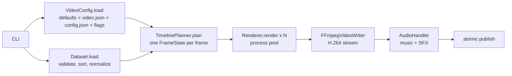

# Architecture

## Source map

```text
src/fromversionzero/
├── cli.py                  commands, config/data-root discovery, dataset lookup
├── config.py               pydantic schema, layered loading, immutable VideoConfig
├── themes.py               theme palettes and font roles
├── data_loader.py          CSV parsing/validation; Dataset with normalized series
├── timeline.py             pure frame planning: Timeline, FrameState, SFX cues
├── interpolator.py         easing and the damped camera
├── renderer.py             layout scaling, graph primitives, frame entry point
├── renderer_landscape.py   landscape composition, intro/outro cards
├── renderer_portrait.py    Shorts composition
├── components.py           product card, facts card, Shorts hero, generation mark
├── asset_manager.py        fonts (variable weights), icons, units, images, logos
├── media.py                download and cache linked logos/images (media.logo, image URLs)
├── marks.py                redraw a logo or photo as line art (fromversionzero mark)
├── encoder.py              raw frames -> FFmpeg (libx264/libx265)
├── audio_handler.py        music + SFX mixing
├── video_pipeline.py       orchestration and process pool
└── resources/              Montserrat variable font, metric icons, brand mark
schema/config.schema.json   generated contract for config files
tests/                      unit, golden-frame, CLI and end-to-end tests
tests/fixtures/data/        synthetic dataset used by the tests
examples/                   one dataset copied from fromversionzero-data (checked in CI)
```

## Data flow



1. **Configuration** — each JSON layer is validated by the pydantic
   `ConfigFile` model (strict types, unknown keys rejected), layers are
   deep-merged, and the result is resolved into a frozen `VideoConfig`.
   `for_output_mode()` returns the Shorts variant; nothing mutates a config.
2. **Data** — `DataLoader` validates the CSV; `Dataset` selects the plotted
   metrics and precomputes every plotted coordinate (`log10(value / first)` or
   the plain ratio), so rendering only does lookups.
3. **Planning** — `TimelinePlanner` is the only stateful step (the camera
   follows the curves with exponential damping). It produces immutable,
   picklable `FrameState`s and the SFX cue list. It has no rendering code.
4. **Rendering** — `Renderer.render(FrameState) -> RGB array` is a pure
   function of its inputs, so frames render in any order across worker
   processes (each builds its own `Renderer`). A test asserts parallel and
   sequential output are byte-identical. Worker errors fail the render; only an
   unavailable process pool falls back to sequential rendering.
5. **Encoding** — frames stream into FFmpeg over a pipe (no intermediate
   images). Audio is mixed into a copy of the stream; if that fails the silent
   render is kept. Files are written to temp names and atomically renamed.

## Rendering model

- **Design units.** Layout constants are authored on a reference canvas
  480 units tall (landscape) or 1080 units wide (portrait). `Renderer.unit` is
  the smallest integer scale giving at least `ssaa_factor`× supersampling; the
  canvas is downsampled to the output size. Every resolution therefore has the
  same composition.
- **Blending.** The canvas is RGB and drawn with `BlendDraw`, an `ImageDraw`
  that alpha-blends shapes *and* text (Pillow draws text opaque otherwise).
- **Fading** of the graph during intro/outro uses the `Renderer.faded()`
  context manager, which always restores the palette.
- **Clipping.** Curves and points are drawn inside `clipped_to_graph()`, so a
  lagging camera never spills curves into the HUD.

## Testing strategy

| Layer | Tests |
| --- | --- |
| Config, data, timeline | pure unit tests |
| Renderer | properties (format, determinism, toggles, resolution independence) |
| Look | golden frames in `tests/golden/` (tight tolerance; update with `FVZ_UPDATE_GOLDEN=1`) |
| Pipeline | real FFmpeg encodes, audio mix, failure paths, parallel = sequential |
| CLI / packaging | CLI in-process; CI installs the wheel and renders a video |
| Datasets | `examples/` validated here; the full collection in its own repo's CI |

## Datasets

Code-owned assets (icons, brand mark, fonts) live in the package. Datasets
live in the separate `fromversionzero-data` repository, which has no releases
of its own: its CI validates every dataset against this repository's `main`
branch. They are located through `--data-root` (default `./data`, which is
gitignored here so a clone or symlink can sit in the checkout). The JSON
Schema plus `validate` form the contract between the two repositories.

## Extension points

- New theme: add it to `themes.py` (8 distinct `line_colors`) and a golden case.
- New output format: add a composition module next to `renderer_landscape.py`
  and a design size in `DESIGN_SHORT_SIDE`.
- New on-screen copy: add a field to `config.Labels`.
