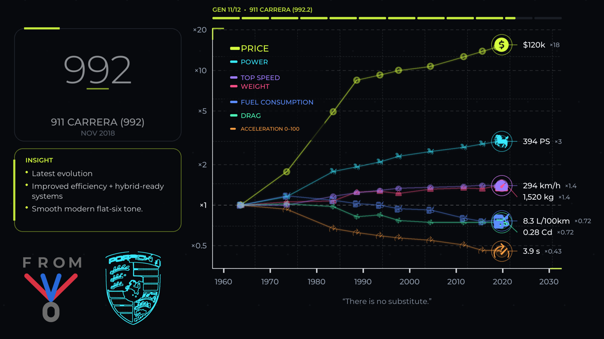
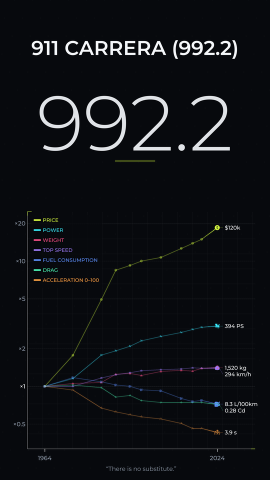

#  FromVersionZero 🎬📈

Render animated videos that show how a product evolved, generation by
generation: every metric becomes a curve measured as a multiple of the first
version (×1 → ×15), with the product, its milestones and an optional
soundtrack. One dataset produces both a landscape video and a portrait Short.




## Features

- **Story-first chart**: log axis labelled in multiples of the first
  generation, values with units (`$97k ×15`, `385 hp ×3`), animated legend.
- **Landscape and Shorts** from the same data, with resolution-independent
  layouts: 480p previews and 4K masters look identical.
- **Broadcast-ready output**: H.264 (or H.265), BT.709, `+faststart`; optional
  music and per-generation sound effects.
- **Three themes** (`signal`, `blueprint`, `paper`) with full color, font and
  copy overrides.
- **Strict validation**: unknown config keys, bad types and broken datasets are
  reported before rendering; a JSON Schema documents every option.
- **Fast**: frames are planned once, rendered in parallel and streamed to
  FFmpeg (an 86-second 1080p video renders in ~30 s on 24 cores).

## Quick start

Requires Python 3.12+ on Linux, macOS or Windows. FFmpeg is bundled through
`imageio-ffmpeg`; no system libraries are needed.

```bash
git clone https://github.com/ninja7v/fromversionzero.git
cd fromversionzero
uv sync                                   # or: python -m venv .venv && pip install -e .
uv run fromversionzero --data-root examples --product Porsche_911 --resolution 480p
uv run fromversionzero --data-root examples --product Porsche_911 --shorts
```

From a source checkout without installing,
`python main.py --data-root examples --product Porsche_911` works too.

The full collection of datasets (cars, phones, AI models, races...) lives in
its own repository. Clone it as `data/` (the default data root) or anywhere
else and pass `--data-root`:

```bash
git clone https://github.com/ninja7v/fromversionzero-data.git data
uv run fromversionzero --product Tesla_Model_S
```

## Commands

```bash
fromversionzero render   --product NAME [--shorts] [--resolution 720p] [--output-folder DIR]
fromversionzero validate [--product NAME] [--strict] [--check-media]   # every dataset when no product is given
fromversionzero list                                   # datasets under the data root
fromversionzero schema   [-o schema.json]              # JSON Schema of config files
fromversionzero mark     SOURCE OUTPUT [--levels 2]    # redraw an image file or URL as line art
```

`render` is the default command. Datasets are found under `--data-root`,
`$FVZ_DATA_ROOT` or `./data`; the project config is `--config`, `$FVZ_CONFIG`
or `./video.json`. `--product` accepts a name, `Category/Name` or a path.

## Datasets

```text
<data root>/<Category>/<Product>/
├── data.csv        # one row per generation (required)
├── config.json     # title, motto, theme, metrics... (required)
├── description.md  # sources and methodology
├── images/         # optional product images (or link them in data.csv)
├── logo.png        # optional brand logo (or link it with media.logo)
└── soundtrack.mp3  # optional music
```

```csv
name,date,power,price,image,fact,speculation
V1,2018.09,100,1500,,First launch.,false
V2,2022.09,180,2200,,Redesigned generation; Faster charging,false
V3,2026.09,240,2800,,Speculation: next generation.,true
```

See the [Dataset Guide](docs/DATASET_GUIDE.md) and the
[Configuration Reference](docs/CONFIGURATION.md).

## Development

```bash
uv sync --extra dev
uv run pytest                       # unit, golden-frame and end-to-end tests
uv run ruff check . && uv run ruff format --check . && uv run mypy
FVZ_UPDATE_GOLDEN=1 uv run pytest tests/test_golden.py   # after intended visual changes
```

See [CONTRIBUTING.md](CONTRIBUTING.md), [ARCHITECTURE.md](ARCHITECTURE.md)
and the [CHANGELOG](CHANGELOG.md).

## License

Code and project-owned assets are released under the [MIT License](LICENSE.txt).
The Montserrat font is under the SIL Open Font License 1.1. The datasets in
[fromversionzero-data](https://github.com/ninja7v/fromversionzero-data) are
under CC BY 4.0; they link third-party logos and images, which are **not**
covered by either license. See the [Asset Policy](ASSET_POLICY.md).
